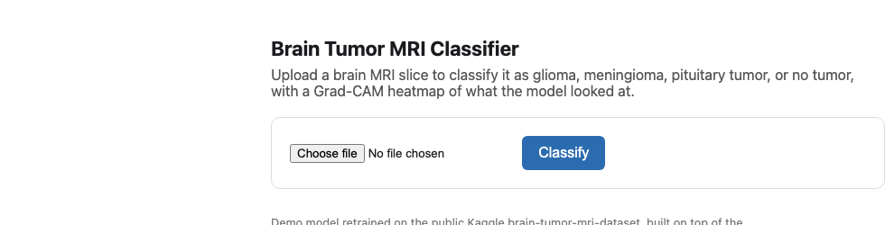
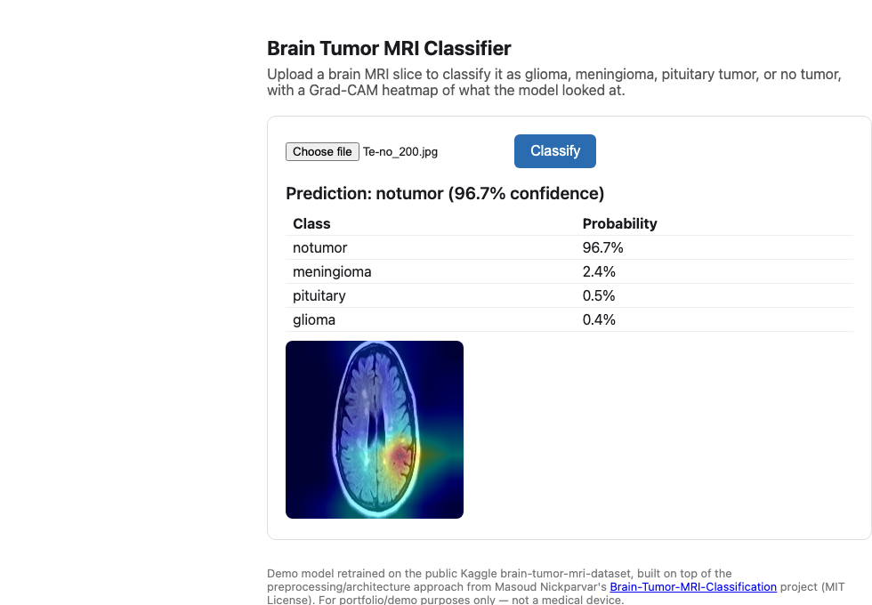
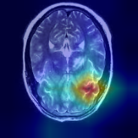
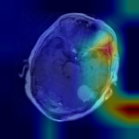

# Brain Tumor MRI Classifier — Retrained + Explainable + Demo

> **This project is built on top of, and credits in full, the [Brain-Tumor-MRI-Classification](https://github.com/masoudnick/Brain-Tumor-MRI-Classification) project by [Masoud Nickparvar](https://github.com/masoudnick), released under the MIT License.**
> The original repository's preprocessing pipeline, model architecture, and training notebook are the base this project builds on (a copy of the original notebook is kept in `notebooks/` for reference). The original dataset used is Masoud Nickparvar's [Brain Tumor MRI Dataset on Kaggle](https://www.kaggle.com/datasets/masoudnickparvar/brain-tumor-mri-dataset). None of the base pipeline is presented as original work here — see "What's original in this repo" below for exactly what was added.

## What's original in this repo

Starting from the base pipeline above, this project adds:

1. **An actual retrained model** — `src/train.py` reruns the preprocessing (bilateral
   filter + `COLORMAP_BONE` pseudo-coloring, 200x200) and a ResNet50 transfer-learning
   head (`GlobalAveragePooling2D -> Dropout(0.4) -> Dense(4, softmax)`) on the real local
   copy of the dataset, and saves a genuine trained model file plus a JSON file of the
   real metrics from that run (`models/training_metrics.json`). The ResNet50 backbone is
   **frozen** (only the ~8K-parameter head is trained) — a deliberate change from the
   original notebook, which left the backbone trainable end-to-end over 50 epochs. This
   keeps retraining practical on a laptop; see "Real results" below for what that trade-off
   produced.
2. **Grad-CAM explainability** (`src/gradcam.py`) — a standard Keras/TF Grad-CAM
   implementation against the ResNet50 backbone's last convolutional block
   (`conv5_block3_out`), producing a heatmap overlay showing which MRI regions drove each
   prediction. Sample overlays for each class are in `gradcam_samples/`.
3. **A working upload-and-classify web demo** (`backend/`) — a small FastAPI backend that
   loads the retrained model, accepts an uploaded MRI image, and returns the predicted
   class, confidence, per-class probabilities, and a Grad-CAM heatmap overlay (base64 PNG),
   plus a single static HTML/JS page for uploading an image and viewing the result.

## Real results

Real training run (frozen ResNet50 backbone, head-only training, 15 epochs, batch size 32,
200x200 input, on the actual local copy of the dataset — 4,480 train / 1,120 validation /
1,600 test images):

| Metric | Value |
| --- | --- |
| Epochs run | 15 / 15 (no early stop triggered) |
| Best validation accuracy | 61.4% |
| Best validation loss | 1.111 |
| **Test accuracy** | **55.6%** |
| Test loss | 1.230 |

Per-class test performance:

| Class | Precision | Recall | F1 |
| --- | --- | --- | --- |
| glioma | 0.51 | 0.46 | 0.49 |
| meningioma | 0.45 | 0.46 | 0.46 |
| notumor | 0.63 | 0.68 | 0.65 |
| pituitary | 0.63 | 0.62 | 0.62 |

Full history, the confusion matrix, and the classification report are in
`models/training_metrics.json`.

These numbers come from an actual training run on the full local copy of the dataset
(1,400 training images and ~400 testing images per class, 4 classes: glioma, meningioma,
notumor, pituitary) — not the 98.76% figure reported in the original repo's README, which
reflects their own (different, full-fine-tune) training run, not this one.

A supplementary PDF co-authored by the project owner, `assets/DL-with-Python-Research-paper.pdf`,
benchmarks this same ResNet50 pipeline against a cited 2018 baseline. Its stated
hyperparameters (Dropout 0.5, 224x224 input) differ slightly from the actual notebook and
this retraining run (Dropout 0.4, 200x200) — that discrepancy is in the paper itself, not
corrected here; the real notebook/retrained values above are the ground truth for this
README and the demo.

## Screenshots

**The upload-and-classify demo, run live against the real retrained model:**





**Grad-CAM heatmaps from the real model** (which MRI regions drove the prediction):

| `notumor` (0.95 confidence) | `meningioma` (0.31 confidence) |
|---|---|
|  |  |

More samples (including a few incorrect predictions, left in rather than cherry-picked) are in
[`gradcam_samples/`](gradcam_samples/).

## Project structure

```
brain-tumor-classifier/
├── README.md
├── LICENSE                  # MIT, credits both the original and this project's author
├── LICENSE-upstream         # original project's unmodified MIT license text
├── requirements.txt
├── data/                    # dataset not committed -- see data/README.md for how to get it
├── notebooks/
│   └── Brain_Tumor_Classification.ipynb   # original notebook, kept for reference
├── src/
│   ├── model_utils.py       # preprocessing + model architecture (shared)
│   ├── train.py             # retraining script (original code)
│   ├── gradcam.py           # Grad-CAM implementation (original code)
│   └── generate_gradcam_samples.py
├── models/
│   ├── brain_tumor_resnet50.keras    # retrained model (this run)
│   └── training_metrics.json          # real metrics from this run
├── gradcam_samples/         # sample Grad-CAM heatmap overlays, 1-2 per class
├── backend/
│   ├── app.py               # FastAPI inference backend
│   └── static/index.html    # minimal upload-and-classify frontend
└── assets/
    └── DL-with-Python-Research-paper.pdf   # supplementary comparative-analysis writeup
```

## Setup

```bash
python3.12 -m venv venv
source venv/bin/activate
pip install -r requirements.txt
```

(Tested on Apple Silicon with `tensorflow-macos` + `tensorflow-metal`; on Linux/other
platforms `tensorflow` installs instead per `requirements.txt`.)

### Get the dataset (only needed to retrain)

See `data/README.md` — download from Kaggle and place it under `data/Training` /
`data/Testing`, or point `--data-dir` at wherever you already have it.

### Retrain the model

```bash
python src/train.py --data-dir /path/to/dataset --epochs 15
```

Saves `models/brain_tumor_resnet50.keras` and `models/training_metrics.json`.

> **Apple Silicon note:** `tensorflow-metal` GPU training hung (no progress) during this
> project's own training run. Set `FORCE_CPU=1` before the command above to force
> CPU-only training if you hit the same issue — training is slower but reliable:
> `FORCE_CPU=1 python src/train.py --data-dir /path/to/dataset --epochs 15`.

### Generate Grad-CAM samples

```bash
python src/generate_gradcam_samples.py --data-dir /path/to/dataset --model-path models/brain_tumor_resnet50.keras
```

### Run the demo

```bash
uvicorn backend.app:app --reload --port 8000
```

Then open http://localhost:8000 in a browser, upload an MRI image (e.g. one of the test
images from the Kaggle dataset), and submit to see the predicted class, confidence, and a
Grad-CAM heatmap overlay.

## Disclaimer

This is a portfolio/educational demo, not a medical device. Predictions should never be
used for actual diagnosis.

## Credits

- **Original pipeline, architecture, and dataset curation:** [Masoud Nickparvar](https://github.com/masoudnick) — [Brain-Tumor-MRI-Classification](https://github.com/masoudnick/Brain-Tumor-MRI-Classification) (MIT License) and the [Brain Tumor MRI Dataset](https://www.kaggle.com/datasets/masoudnickparvar/brain-tumor-mri-dataset) on Kaggle.
- **Retraining, Grad-CAM explainability, and the web demo:** Abhinav Singh.
